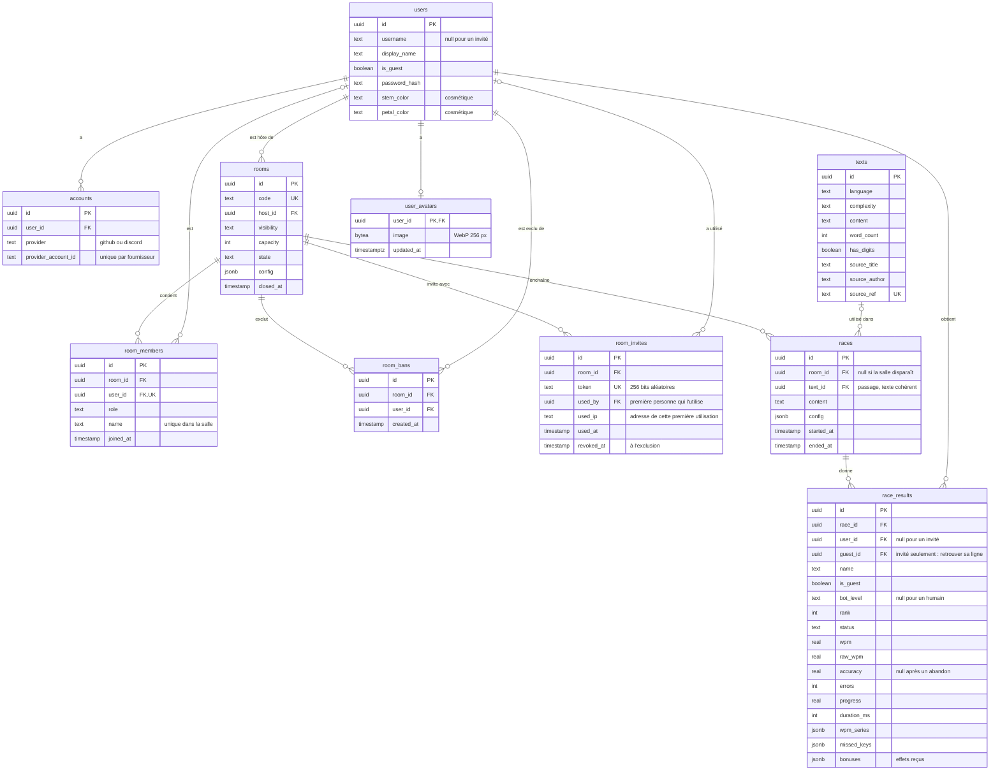
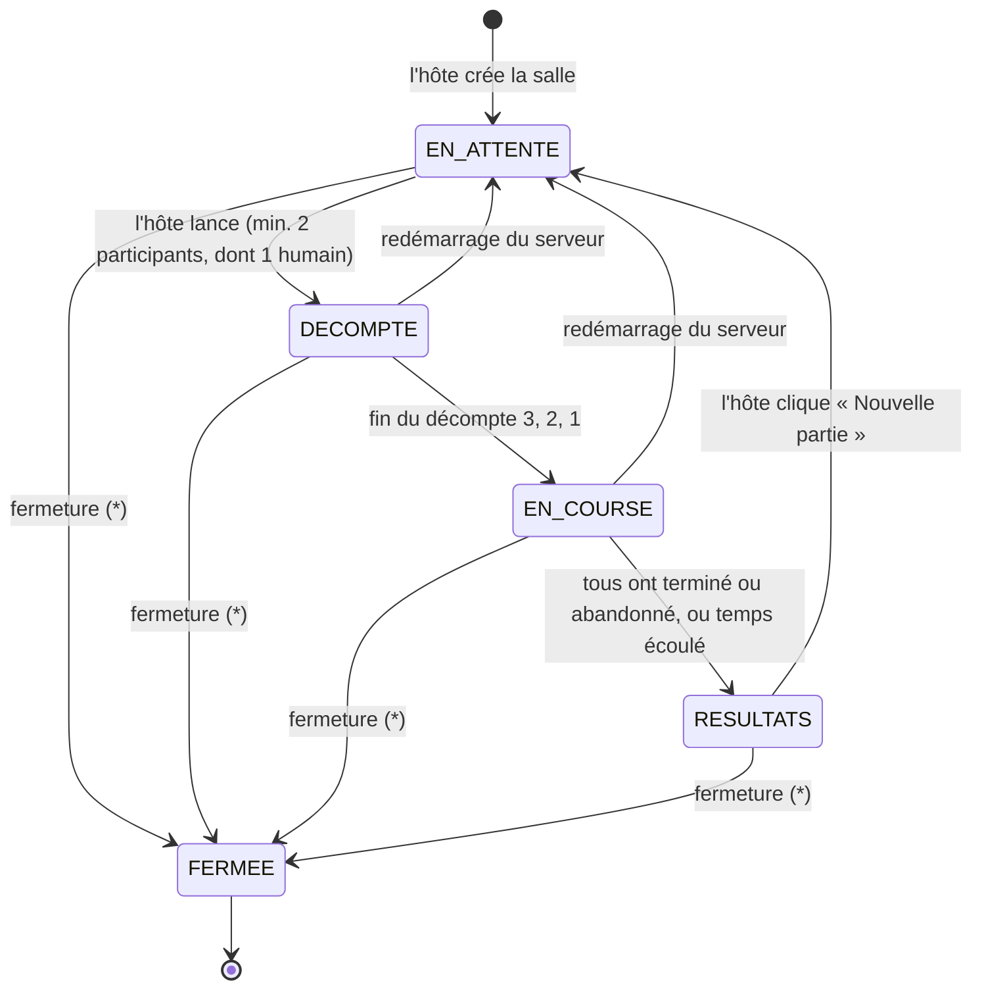
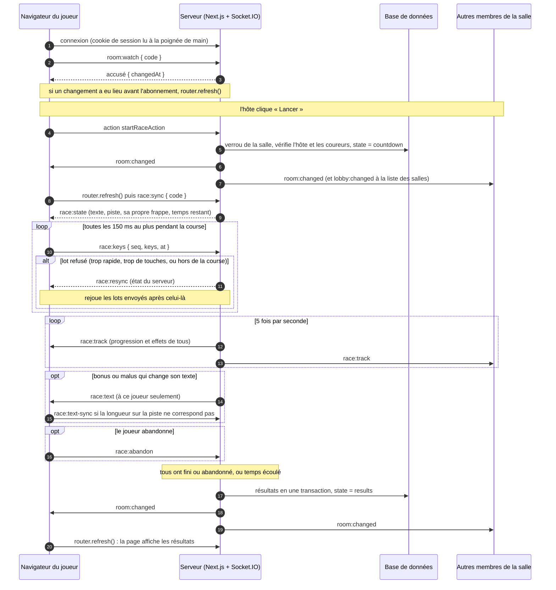

# Architecture

Les tables `users`, `user_avatars`, `accounts`, `texts`, `rooms`, `room_members`, `room_bans`, `room_invites`, `races` et `race_results` existent. Le diagramme montre les colonnes utiles pour comprendre le modèle ; les `created_at` et `updated_at` sont omis.

## Modèle de données

Quelques précisions :

- `accounts` sert pour les connexions Discord et GitHub. `password_hash` est null si le compte utilise seulement OAuth.
- Un membre de salle est toujours une ligne de `users` (`user_id`), invités compris : un invité (AUTH-02) est un utilisateur avec `is_guest` et sans `username`. `role` est participant ou spectateur.
- Pour SALLE-06, `room_members.user_id` a une contrainte unique, donc une personne ne peut pas être dans deux salles en même temps, même si l'interface a un bogue ou si deux onglets envoient la demande en même temps. Comme les invités sont des lignes de `users`, la même contrainte s'applique à eux.
- Le code de salle a un index unique et une contrainte `check` sur son format (6 caractères sans 0/O ni 1/I/L, SALLE-02). La capacité est vérifiée entre 2 et 30 par la base aussi (SALLE-05).
- La visibilité et la capacité ont leur propre colonne parce que la liste des salles filtre dessus. Le reste de la configuration (texte, temps, mode d'erreur, bonus) est dans la colonne `jsonb` `config`, parce que ce sont beaucoup d'options qui sont toujours lues ensemble. Elle est relue avec le schéma Zod `raceConfigSchema`.
- Quand l'hôte quitte, le membre connecté avec un compte présent depuis le plus longtemps (`joined_at`) devient l'hôte ; s'il n'y en a pas, la salle passe à `closed` (SALLE-08). Rejoindre ou quitter verrouille la ligne de la salle (`select ... for update`), pour que deux personnes ne prennent pas la dernière place en même temps.
- Quand l'hôte exclut quelqu'un (SALLE-07), son départ est enregistré dans `room_bans`, avec un index unique sur (`room_id`, `user_id`). Rejoindre la salle vérifie cette table, donc la personne ne peut plus revenir. Un invité qui efface ses cookies devient un nouvel utilisateur : la base ne peut pas le reconnaître.
- Un lien d'invitation (SALLE-04) est une ligne de `room_invites`. Son jeton fait 32 octets aléatoires (256 bits) et a un index unique. La première utilisation enregistre `used_by` et `used_ip` ; ensuite, le lien ne marche que pour cette personne, depuis cette adresse. Exclure quelqu'un remplit `revoked_at` sur ses liens. Quand la salle ferme, tous ses liens deviennent invalides, parce que l'état de la salle est vérifié à chaque utilisation.
- `texts` contient les passages des textes cohérents. Leur provenance et le calcul de la difficulté sont expliqués dans [TEXTES.md](TEXTES.md).
- `races` garde le texte exact et la configuration de la course, pour réafficher les résultats plus tard (HIST-02).
- `race_results` a une ligne par participant, invités compris, pour que le tableau complet puisse être réaffiché. Mais la ligne d'un invité n'a pas de `user_id` : elle ne devient jamais son historique (AUTH-03, RES-05). `wpm_series` garde le MPM échantillonné chaque seconde et `missed_keys` les touches ratées, pour les graphiques (RES-03).
- Index pour le nettoyage des données (TECH-04) : un index partiel sur `users.created_at` pour les invités seulement (trouver les invités expirés), `rooms.closed_at` (les salles fermées depuis longtemps), et `rooms.host_id` et `race_results.guest_id`, pour que supprimer un invité ne parcoure pas toute la table lors de la cascade. La tâche de nettoyage elle-même n'est pas encore écrite.
- La progression pendant la course n'est pas dans la base de données. Elle reste en mémoire sur le serveur et les résultats sont écrits une seule fois à la fin (PERF-02).

## Machine à états d'une course

C'est la machine à états de COURSE-01. L'état est la colonne `rooms.state` (`waiting`, `countdown`, `racing`, `results`, `closed`, dans `lib/rooms/settings.ts`). Le diagramme garde les noms de l'énoncé.

(*) Une salle ferme, dans n'importe quel état, dans trois cas :

- l'hôte supprime la salle ;
- le dernier membre connecté part ;
- l'hôte part et aucun membre connecté avec un compte ne peut le remplacer (un invité ne devient jamais hôte).

Quand la salle ferme pendant une course, la course s'arrête : les coureurs encore en route comptent comme ayant abandonné, les résultats sont enregistrés, et la salle reste `closed`. Chaque membre libéré reçoit `room:closed`.

- On peut rejoindre la salle seulement dans `EN_ATTENTE` et `RESULTATS` (SALLE-09), sinon on est spectateur.
- Le texte est envoyé aux joueurs seulement quand on arrive dans `DECOMPTE` (COURSE-03).
- C'est le serveur qui fait toutes les transitions. Le client ne fait que demander, et le serveur vérifie que c'est bien l'hôte (SEC-01). Lancer et passer à « Nouvelle partie » vérifient l'état dans la même requête, donc deux clics ne font la transition qu'une fois.
- La course est en mémoire (voir l'ADR 1). Au redémarrage, une salle restée en `DECOMPTE` ou `EN_COURSE` revient donc en `EN_ATTENTE`, sans résultats.

## ADR 1 : Technologie temps réel

**Statut :** accepté

**Contexte :** Il faut que tout le monde dans une salle voit la liste des personnes, la configuration et la progression des joueurs en direct (TECH-06). Le joueur envoie aussi sa progression au serveur plusieurs fois par seconde, donc la communication doit aller dans les deux sens. Le serveur doit être la source de vérité (COURSE-06).

**Décision :** J'utilise des WebSockets avec Socket.IO, sur un serveur Node personnalisé qui roule dans le même processus que Next.js.

**Options considérées :**

| Option | Pourquoi oui / non |
| --- | --- |
| Socket.IO (choisi) | Bidirectionnel, les « rooms » correspondent directement à mes salles, et la reconnexion automatique m'aide pour COURSE-08. |
| WebSocket natif (`ws`) | Plus léger, mais je devrais refaire moi-même les salles et la reconnexion. |
| Server-Sent Events | Va seulement du serveur vers le client, donc il faudrait des requêtes HTTP à part pour la progression. |
| MQTT | Demande un broker en plus à installer et maintenir sur le serveur, c'est trop pour ce projet. |
| Service externe (Pusher, Ably) | Limites du forfait gratuit (TECH-08) et c'est plus difficile d'avoir un serveur autoritaire. |

**Conséquences :**

- Il faut un serveur qui reste toujours allumé, donc pas d'hébergement serverless. Ce n'est pas un problème puisque le déploiement doit être sur un VPS de toute façon (TECH-05).
- L'état des courses est en mémoire dans un seul processus. Si le serveur redémarre, les courses en cours sont perdues. Je trouve ça acceptable pour la taille du projet.
- Tous les messages reçus par le serveur seront validés avec un schéma Zod (TECH-07).

## Mise en œuvre du temps réel

- `server.ts` démarre Next.js et Socket.IO sur le même serveur HTTP. Node l'exécute directement en développement (suppression des types) ; `bun run build` le compile en `build/server.mjs` pour la production, car le Node du VPS n'a pas la suppression des types. Ce fichier n'importe aucun code de l'application. Le serveur Socket.IO est rangé sur `globalThis`, et `instrumentation.ts` y branche les gestionnaires de `lib/realtime/handlers.ts` au démarrage de Next.
- La poignée de main lit le cookie de session : un utilisateur connecté est identifié, un invité peut quand même se connecter pour suivre la liste des salles.
- Les noms des messages sont dans `lib/realtime/events.ts`, partagés par le serveur et le navigateur. Hors course, le serveur envoie seulement des avis « cette salle a changé » (`room:changed`) et « la liste a changé » (`lobby:changed`). La page se rafraîchit alors côté serveur (`router.refresh()`), ce qui refait toutes les vérifications de droits. Quand une salle ferme, chaque membre libéré reçoit `room:closed` avec la raison, pour être prévenu. La course a ses propres messages, avec les données (voir plus bas).
- Une page s'abonne avec `room:watch` ou `lobby:watch` et se désabonne avec `room:unwatch` ou `lobby:unwatch`. Suivre une salle est validé avec Zod et permis seulement pour une salle publique ou pour un membre (TECH-07).
- Présence : chaque onglet ouvert garde un socket. Un membre qui n'a plus aucun onglet ouvert pendant 30 secondes est considéré comme parti (même délai que COURSE-08). Ça libère sa place et, si c'était l'hôte, passe le rôle au membre connecté présent depuis le plus longtemps (SALLE-08). Après un redémarrage du serveur, les membres qui ne se reconnectent pas dans les 30 secondes partent aussi.
- L'état temps réel (sockets ouverts, minuteries) est sur `globalThis`, parce que `server.ts`, l'instrumentation et les server actions ne partagent pas les mêmes instances de modules.

## Proxy

`proxy.ts` passe avant chaque page (le `middleware` de Next 16 s'appelle maintenant `proxy`) :

- Une adresse sans langue (`/rooms/…`) est redirigée vers `/fr` ou `/en`, selon le choix gardé dans un cookie ou la langue préférée du navigateur.
- Une page qui demande un compte (`/stats`, `/account`, `/rooms/new`, liste dans `lib/auth/session-cookie.ts`) envoie tout de suite un visiteur sans cookie de session vers la page de connexion (307). Sans ça, la page répondait 200 puis redirigeait après coup, ce qui coûtait plusieurs secondes sur un téléphone. Le proxy regarde seulement si le cookie existe : un cookie périmé ou falsifié arrive quand même à la page, dont `requireUser` vérifie la signature.
- Un code de salle inconnu ou un lien d'invitation mort est réécrit vers `/rooms/gone` ou `/invite/gone`, avec un vrai statut 404 (`lib/rooms/missing-pages.ts`). Si la base de données ne répond pas, le proxy laisse passer et la page affiche l'erreur.

## Limites de tentatives

Les limites sont des compteurs en mémoire sur une fenêtre fixe (`lib/rate-limit.ts`). L'application roule dans un seul processus, et perdre les compteurs à un redémarrage donne seulement une fenêtre de plus à un attaquant (SEC-02).

| Quoi | Clé | Limite |
| --- | --- | --- |
| Connexions ratées | adresse et nom d'utilisateur | 5 par 15 min |
| Connexions ratées | adresse | 30 par 15 min (`LOGIN_FAILURE_LIMIT`) |
| Codes de salle inconnus | adresse | 10 par minute (`CODE_MISS_LIMIT`) |
| Comptes invités créés | adresse | 20 par 10 min (`GUEST_LIMIT`) |
| Photos de profil envoyées | utilisateur | 10 par 10 min |

Seuls les échecs comptent pour la connexion et les codes : quelqu'un qui tape le bon mot de passe ou le bon code n'est jamais ralenti. Le compteur des codes est gardé sur `globalThis`, parce que le proxy et les pages le partagent. Un invité est créé seulement au moment de rejoindre une salle, et son compte est supprimé si l'entrée échoue (salle pleine, nom refusé) : le cookie de session n'est posé qu'après une entrée réussie.

## ADR 2 : Gestion des bots

**Statut :** accepté

**Contexte :** Des bots doivent pouvoir courir dans une salle avec des humains et dans le mode entraînement (BOT-01). Leur vitesse doit varier pendant la course (BOT-02), ils doivent faire des erreurs et respecter le mode d'erreur (BOT-03), recevoir les bonus et malus comme les humains (BOT-04), et leur comportement doit être déterministe à partir d'une graine, pour être testé (BOT-05). Dans une salle, le serveur est la source de vérité (COURSE-06). Un bot ne doit pas prendre la place d'un humain ni entrer dans un historique.

**Décision :** Un bot est un participant du moteur de course (`lib/race/engine.ts`), comme un humain, avec un niveau et une graine. Un « typiste » (`lib/bots/typist.ts`) décide chaque touche et son délai à partir du texte actuel du bot et de son état de frappe, avec un générateur à graine. Dans une salle, il tourne sur le serveur, dans le même processus que la course ; à l'entraînement, il tourne dans le navigateur, dans le même moteur. Les bots d'une salle sont gardés dans sa configuration (`rooms.config`), pas dans `users` ni `room_members`.

**Options considérées :**

| Option | Pourquoi oui / non |
| --- | --- |
| Participant du moteur, touche par touche (choisi) | Le bot passe par les mêmes règles de frappe que les humains : erreurs, mode d'erreur, texte changé par un bonus et classement marchent sans code à part. Avec la graine, une course se rejoue à l'identique dans les tests. |
| Progression calculée d'après le temps (une courbe) | Plus simple, mais un bot ne taperait aucune touche : impossible de faire de vraies erreurs, de respecter le mode d'erreur ou de suivre un texte raccourci ou allongé par un bonus. |
| Faux client Socket.IO (un processus qui se connecte comme un joueur) | Teste tout le chemin réseau, mais demande un processus à part, les délais du réseau rendent la course non déterministe, et le serveur devrait faire confiance à ce client comme à un humain. |
| Bots comme lignes de `users` et `room_members` | Les réutiliserait partout, mais ils prendraient de la capacité, compteraient pour SALLE-06 et pourraient entrer dans les historiques. |
| Bots de l'entraînement sur le serveur | Le serveur arbitrerait aussi l'entraînement, mais il faudrait une salle et un socket pour une course seul, alors que ses résultats ne sont pas enregistrés. |

**Conséquences :**

- Les bots d'une course sont en mémoire avec elle : un redémarrage du serveur les perd aussi (voir l'ADR 1).
- Le serveur simule chaque touche de chaque bot. Avec au plus 5 bots par salle, c'est négligeable à côté des humains.
- La graine d'un bot de salle est tirée au lancement et n'est pas enregistrée : les tests rejouent une course à partir d'une graine choisie, mais une course passée ne peut pas être rejouée.
- À l'entraînement, le navigateur fait courir les bots, donc il pourrait les truquer. Comme les résultats de l'entraînement ne sont pas enregistrés, ce n'est pas un problème.
- La ligne de résultats d'un bot a `bot_level` et pas de `user_id` : elle n'entre dans aucun historique.

Le détail du comportement des bots est dans la section suivante.

## Mise en œuvre des bots

Les bots courent dans le même moteur que les humains (`lib/race/engine.ts`) : sur le serveur pour une salle, dans le navigateur pour l'entraînement. Pour le moteur, un bot est un participant avec un niveau et une graine ; sa progression part sur la piste comme celle d'un humain, et il reçoit les bonus et malus (BOT-04).

- **Le typiste (`lib/bots/typist.ts`).** `BotTypist` décide une touche à la fois, à partir du texte actuel du coureur et de son état de frappe : il suit donc un texte raccourci ou allongé par un bonus. Tout le hasard vient d'un générateur à graine : même graine, même niveau et mêmes touches donnent la même course, ce qui le rend testable (BOT-05).
- **Vitesse (BOT-01, BOT-02).** Au départ, le bot vise un MPM tiré dans les 80 % du milieu de la plage de son niveau. Sa vitesse change à chaque mot (une humeur qui dérive), avec des rafales de 2 à 5 mots plus rapides, des hésitations en début de mot (plus fréquentes aux niveaux lents), et il ralentit sur les mots de 8 lettres ou plus et sur les majuscules, chiffres, ponctuation et accents. Chaque touche varie aussi de ±25 %. Le soleil aveuglant le ralentit de 85 % (15 % de sa vitesse) jusqu'à la fin de l'éblouissement, même au milieu d'une touche, puis il reprend sa vitesse normale. La pluie et la nuit changent son texte comme celui d'un joueur, et il suit le nouveau texte à la touche suivante. Les pauses sont comptées en « temps de touche » du bot, et le temps de touche est calculé depuis le MPM visé avec un coût moyen par caractère mesuré sur le corpus ; les tests vérifient que la moyenne de chaque niveau tombe dans sa plage.
- **Erreurs (BOT-03).** À chaque caractère, le bot se trompe selon le taux de son niveau, sur une touche voisine du clavier. En correction obligatoire, il est bloqué dès la lettre fausse : il marque un temps de réaction et l'efface. En mode libre, il corrige tout de suite une fois sur deux, sinon il hésite et continue en laissant l'erreur.
- **Dans le moteur.** À chaque `tick`, le moteur joue les touches du bot jusqu'à maintenant, chacune à l'heure où le bot l'a tapée : son temps d'arrivée ne dépend pas du moment du tick. Choix : une course se termine quand plus aucun humain ne court ; les bots encore en route sont classés selon leur progression, comme à la limite de temps, et les résultats les marquent « Pas fini ».
- **Salles.** L'hôte ajoute jusqu'à 5 bots dans les réglages (création ou modification), gardés dans la colonne `config` de la salle. Ils ne prennent pas de place dans la capacité, qui compte les humains. Ils comptent pour le minimum de 2 coureurs, mais il faut au moins un humain (COURSE-02). Leur ligne de résultats a `bot_level` et pas de compte : elle n'entre dans aucun historique.

## Mise en œuvre de la course

- **Logique pure, partagée.** `lib/race/typing.ts` est un réducteur : il prend une touche (un caractère ou un retour arrière) et donne le nouvel état de frappe. Le navigateur l'utilise pour afficher tout de suite le résultat de chaque touche, et le serveur rejoue les mêmes touches avec lui. Les deux sont donc toujours d'accord, et les chiffres officiels sont ceux du serveur (COURSE-06). Les formules de l'annexe A sont dans `lib/race/stats.ts`.
- **Mode d'erreur (CONF-08).** Correction obligatoire : la lettre fausse reste en rouge et aucune autre touche n'est acceptée tant qu'elle n'est pas effacée. Libre : on avance quand même et l'erreur est comptée. Dans les deux modes, un mot est gardé une fois l'espace qui le suit tapé (en correction obligatoire, seulement s'il est juste).
- **Moteur (`lib/race/engine.ts`).** Une classe pure : chaque méthode reçoit l'heure, donc les tests contrôlent le temps. Elle refuse les touches pendant le décompte, après la limite de temps et d'une personne qui ne court pas. Contre la triche, un « seau » de touches se remplit à 17 touches/s (environ 200 MPM soutenus, au-dessus des meilleurs humains en compétition) jusqu'à 40, et un lot qui en demande plus est refusé en entier. La réserve de 40 laisse passer un mot rapide ou des messages arrivés groupés après un ralentissement du réseau, sans augmenter la vitesse sur toute une course. Un message contient au plus 60 touches. Elle échantillonne le MPM chaque seconde et calcule le classement final (COURSE-10, `lib/race/ranking.ts`).
- **Gestionnaire (`lib/race/manager.ts`).** Il fait toutes les transitions avec de vraies minuteries : l'hôte lance (vérifié sur le serveur sous verrou de ligne, au moins 2 coureurs), le texte est généré à ce moment, le décompte dure 3 s, la piste est envoyée 5 fois par seconde, et la course se termine quand tout le monde a fini ou abandonné, ou à la limite de temps. Les résultats sont écrits en une seule transaction avec le passage de la salle à `results`. Si le serveur redémarre, les salles restées en course reviennent en attente.
- **Messages.** `race:sync` (le navigateur demande la course : texte, piste, et sa propre frappe), `race:keys` (un lot numéroté de touches, toutes les 150 ms au plus, PERF-02), `race:abandon`; le serveur envoie `race:state`, `race:track`, `race:resync` et `race:text` (nouveau texte après un bonus, au coureur visé seulement). Un navigateur qui a raté un `race:text` le redemande avec `race:text-sync`. Tous les messages reçus sont validés avec Zod, et les touches appartiennent toujours à l'utilisateur du socket. Si un lot est refusé, `race:resync` renvoie l'état du serveur et le navigateur rejoue les lots envoyés après celui-là.
- **Départ et reconnexion.** Quitter la salle ou en être retiré pendant une course compte comme un abandon. Après un rechargement, `race:sync` rend sa frappe au coureur ; sans onglet ouvert pendant 30 s, la présence le retire de la salle, ce qui compte comme un abandon (COURSE-08).
- **Piste (COURSE-05).** Chaque coureur est une fleur (`GrowingStem`) qui pousse avec sa progression et fleurit à l'arrivée. Entre deux mises à jour, la progression affichée rejoint la vraie image par image, pour que les fleurs poussent sans saccades.
- **Composants partagés.** La piste, la zone de frappe (`TypingBox` et `useTyping`), le décompte, le dialogue d'abandon et les résultats sont dans `app/components/race/`, sans dépendre d'une salle ni du socket. La zone de frappe d'une salle (`typing-area.tsx`) ajoute seulement l'envoi des touches au serveur et la resynchronisation.

## Flux des messages temps réel

Le diagramme suit une course dans une salle, du point de vue d'un joueur. Les autres membres et les spectateurs reçoivent les mêmes messages diffusés à la salle. Les flèches pleines sont des messages Socket.IO ; « action » est une server action (requête HTTP).

- Le serveur n'envoie jamais de données de salle dans `room:changed` : la page se rafraîchit côté serveur et refait les vérifications de droits. Seuls les messages `race:*` portent des données, et `race:state` ne part que vers le socket qui l'a demandé.
- Après une déconnexion, Socket.IO se reconnecte, et la page renvoie `room:watch` puis `race:sync`. Le joueur retrouve sa frappe (COURSE-08).
- Quand l'hôte exclut quelqu'un, ses onglets sont retirés du canal de la salle et reçoivent `room:changed` ; quand la salle ferme, chaque membre libéré reçoit `room:closed`.

## Mode entraînement

Une course seul, ouverte à tous sauf à quelqu'un qui est dans une salle (`app/[lang]/practice/`) : la page le renvoie vers sa salle, et la server action du texte le refuse aussi. Elle n'a pas de salle : rien en base, pas de socket.

1. **Réglages.** Les mêmes champs que pour une salle pour le texte, la limite de temps et le mode d'erreur (`TextSettingsSection`, `RaceRulesFields`), plus une liste de bots : jusqu'à 5, chacun avec un niveau (`lib/practice/settings.ts`, `lib/bots/levels.ts`, `app/components/bot-list.tsx`).
2. **Texte.** La server action `practiceTextAction` refuse quelqu'un qui est dans une salle, valide les réglages avec Zod et génère le texte comme pour une salle (`lib/texts/generate.ts`). C'est le seul appel au serveur.
3. **Course.** Le navigateur crée un `Race` (`lib/race/engine.ts`), le même moteur que le serveur : décompte de 3 s, règles de frappe, limite de temps, échantillons de MPM et classement. Les touches acceptées par `useTyping` attendent dans une file et sont passées au moteur au même rythme que les envois d'une salle (`lib/race/pacing.ts`) : un texte qui arrive d'un coup (un expanseur de texte) compte donc au lieu d'être refusé. La piste est rafraîchie 5 fois par seconde.
4. **Résultats.** Le tableau et le podium des salles, avec « Recommencer » (nouveau texte, mêmes réglages) et « Changer les réglages ».

Comme le serveur n'arbitre pas cette course, ses résultats ne sont pas enregistrés. Chaque bot configuré devient un participant du même `Race`, avec une graine tirée au hasard.

## Bonus de rattrapage

Les trois effets viennent des notes de la démarche créative (`docs/DEMARCHE-CREATIVE.md`) : la météo du jardin. Les règles sont des fonctions pures dans `lib/race/bonuses.ts`, appliquées par le moteur ; seul le serveur décide (COURSE-06).

**Règle exacte (BONUS-01).** Quand l'hôte a activé les bonus (CONF-09), chaque fois que la progression du meneur atteint 25 %, 50 % puis 75 % (une seule fois par point de contrôle), deux effets tombent : le bonus (pluie et soleil) pour les retardataires, et un malus pour ceux en tête, nuit ou soleil aveuglant, que le serveur tire au hasard avec un générateur à graine (les tests sont reproductibles). Un effet qui n'a personne à viser est sauté.

- **En retard** : les coureurs encore en course qui sont derniers (tous, en cas d'égalité) ou à plus de 25 % du meneur. Le meneur n'est jamais en retard, et tous ceux à égalité avec lui comptent comme meneurs : à 2 coureurs à égalité, personne n'est en retard.
- **En tête** : les 3 premiers encore en course, sans les retardataires. À un point de contrôle, un coureur reçoit donc un bonus ou un malus, jamais les deux ; à 2 coureurs, le 2e reçoit le bonus et le 1er le malus. La place d'un coureur en tête (pour les 7 %, 5 % et 3 % de la nuit) ne change pas si un autre a déjà reçu le maximum.
- Un coureur reçoit au plus 3 effets par course, bonus et malus confondus.

| Effet | Type | Qui | Ce qui se passe |
| --- | --- | --- | --- |
| Pluie et soleil | bonus | les retardataires | 10 % des mots du texte d'origine en moins, à la fin de leur texte |
| Nuit (au hasard) | malus | les 3 premiers | 7 %, 5 % et 3 % des mots du texte d'origine en plus, à la fin de leur texte |
| Soleil aveuglant (au hasard) | malus | les 3 premiers | leurs 3 prochains mots sont cachés par un éblouissement pendant 5 s |

Les pourcentages sont arrondis, avec au moins 1 mot : sur le texte par défaut de 50 mots, la pluie enlève 5 mots et la nuit en ajoute 4, 3 et 2.

**Texte et progression (BONUS-04).** Chaque coureur a son propre texte dans le moteur. Un bonus ne change que la fin : la pluie garde le mot en cours et 2 mots de marge (le navigateur peut avoir tapé un peu plus que ce que le serveur a reçu), et la nuit ajoute ses mots à la fin, pris dans un 2e texte généré au départ avec les mêmes réglages. Ce qui est déjà tapé reste donc valide. La progression est calculée sur le texte actuel du coureur, et le MPM sur les caractères justes tapés, qui ne changent pas. Le serveur garde aussi les mots retirés par la pluie, dans l'ordre du texte, et envoie au coureur son nouveau texte avec ces mots (`race:text`) ; son état de frappe (`race:sync`, `race:resync`) les contient aussi, donc ils reviennent après un rechargement. Si un `race:text` se perd, le navigateur garderait un texte périmé et pourrait arriver au bout pendant que le serveur attend d'autres mots : la piste donne donc la longueur du texte de chaque coureur, et un navigateur dont le texte diffère pendant plus de 0,5 s redemande le sien (`race:text-sync`). Seule la fin du texte change, donc la frappe n'est pas touchée.

**Affichage (BONUS-03).** La piste reçoit l'effet de chaque coureur avec sa progression : l'icône météo tombe sur sa fleur et le nom de l'effet remplace son statut, 3 s (ou les 5 s de l'éblouissement). Le coureur visé voit en plus un message lu par les lecteurs d'écran. Dans sa zone de frappe, les mots retirés par la pluie restent barrés après la fin du texte (avec « retirés par la pluie » pour les lecteurs d'écran), et l'éblouissement cache ses prochains mots. Les résultats listent les effets reçus par chacun (`race_results.bonuses`, RES-02).
