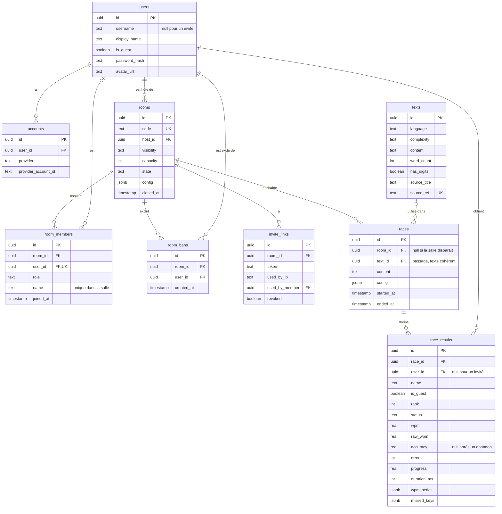
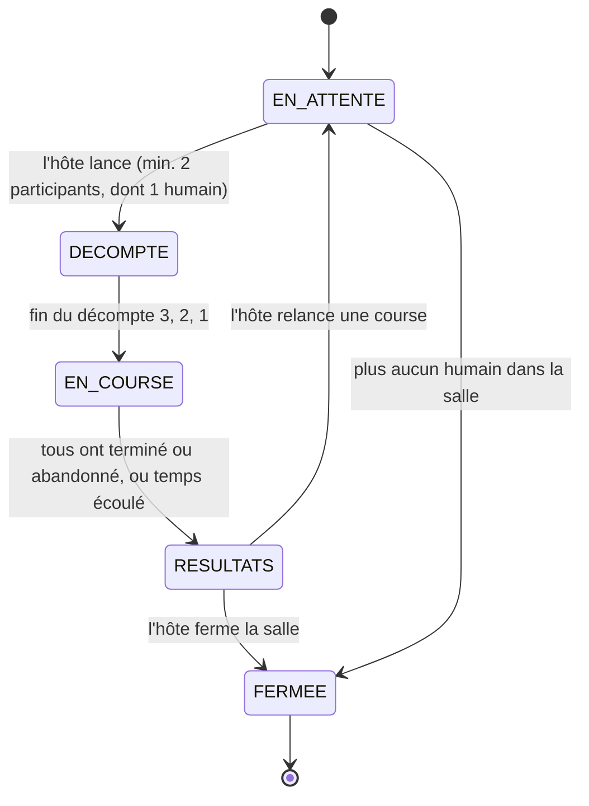

# Architecture

Les tables `users`, `texts`, `rooms`, `room_members`, `room_bans`, `races` et `race_results` existent. Les autres (`accounts`, `invite_links`) sont ce que je prévois faire.

## Modèle de données

Quelques précisions :

- `accounts` sert pour les connexions Discord et GitHub. `password_hash` est null si le compte utilise seulement OAuth.
- Un membre de salle est pour l'instant un utilisateur connecté (`user_id`). Les invités (AUTH-02) auront une colonne `guest_id` qui vient de leur cookie signé. `role` est participant ou spectateur.
- Pour SALLE-06, `room_members.user_id` a une contrainte unique, donc une personne ne peut pas être dans deux salles en même temps, même si l'interface a un bogue ou si deux onglets envoient la demande en même temps. `guest_id` aura la même contrainte.
- Le code de salle a un index unique et une contrainte `check` sur son format (6 caractères sans 0/O ni 1/I/L, SALLE-02). La capacité est vérifiée entre 2 et 30 par la base aussi (SALLE-05).
- La visibilité et la capacité ont leur propre colonne parce que la liste des salles filtre dessus. Le reste de la configuration (texte, temps, mode d'erreur, bonus) est dans la colonne `jsonb` `config`, parce que ce sont beaucoup d'options qui sont toujours lues ensemble. Elle est relue avec le schéma Zod `raceConfigSchema`.
- Quand l'hôte quitte, le membre présent depuis le plus longtemps (`joined_at`) devient l'hôte ; s'il ne reste personne, la salle passe à `closed` (SALLE-08). Rejoindre ou quitter verrouille la ligne de la salle (`select ... for update`), pour que deux personnes ne prennent pas la dernière place en même temps.
- Quand l'hôte exclut quelqu'un (SALLE-07), son départ est enregistré dans `room_bans`, avec un index unique sur (`room_id`, `user_id`). Rejoindre la salle vérifie cette table, donc la personne ne peut plus revenir. Un invité qui efface ses cookies devient un nouvel utilisateur : la base ne peut pas le reconnaître.
- `texts` contient les passages des textes cohérents. Leur provenance et le calcul de la difficulté sont expliqués dans [TEXTES.md](TEXTES.md).
- `races` garde le texte exact et la configuration de la course, pour réafficher les résultats plus tard (HIST-02).
- `race_results` a une ligne par participant, invités compris, pour que le tableau complet puisse être réaffiché. Mais la ligne d'un invité n'a pas de `user_id` : elle ne devient jamais son historique (AUTH-03, RES-05). `wpm_series` garde le MPM échantillonné chaque seconde et `missed_keys` les touches ratées, pour les graphiques (RES-03).
- La progression pendant la course n'est pas dans la base de données. Elle reste en mémoire sur le serveur et les résultats sont écrits une seule fois à la fin (PERF-02).

## Machine à états d'une course

- On peut rejoindre la salle seulement dans `EN_ATTENTE` et `RESULTATS` (SALLE-09), sinon on est spectateur.
- Le texte est envoyé aux joueurs seulement quand on arrive dans `DECOMPTE` (COURSE-03).
- C'est le serveur qui fait toutes les transitions. Le client ne fait que demander, et le serveur vérifie que c'est bien l'hôte (SEC-01).

## ADR 1 : Technologie temps réel

**Statut :** accepté

**Contexte :** Il faut que tout le monde dans une salle voit la liste des personnes, la configuration et la progression des joueurs en direct (TECH-06). Le joueur envoie aussi sa progression au serveur plusieurs fois par seconde, donc la communication doit aller dans les deux sens. Le serveur doit être la source de vérité (COURSE-06).

**Décision :** J'utilise des WebSockets avec Socket.IO, sur un serveur Node personnalisé qui roule dans le même processus que Next.js.

**Options considérées :**

| Option | Pourquoi oui / non |
| --- | --- |
| Socket.IO (choisi) | Bidirectionnel, les « rooms » correspondent directement à mes salles, et la reconnexion automatique m'aide pour COURSE-08. |
| WebSocket natif (`ws`) | Plus léger, mais je devrais refaire moi-même les salles et la reconnexion. |
| Server-Sent Events | Va seulement du serveur vers le client, donc il faudrait des requêtes HTTP à part pour la progression. |
| MQTT | Demande un broker en plus à installer et maintenir sur le serveur, c'est trop pour ce projet. |
| Service externe (Pusher, Ably) | Limites du forfait gratuit (TECH-08) et c'est plus difficile d'avoir un serveur autoritaire. |

**Conséquences :**

- Il faut un serveur qui reste toujours allumé, donc pas d'hébergement serverless. Ce n'est pas un problème puisque le déploiement doit être sur un VPS de toute façon (TECH-05).
- L'état des courses est en mémoire dans un seul processus. Si le serveur redémarre, les courses en cours sont perdues. Je trouve ça acceptable pour la taille du projet.
- Tous les messages reçus par le serveur seront validés avec un schéma Zod (TECH-07).

## Mise en œuvre du temps réel

- `server.ts` démarre Next.js et Socket.IO sur le même serveur HTTP. Node l'exécute directement (suppression des types), donc ce fichier n'importe aucun code de l'application. Le serveur Socket.IO est rangé sur `globalThis`, et `instrumentation.ts` y branche les gestionnaires de `lib/realtime/handlers.ts` au démarrage de Next.
- La poignée de main lit le cookie de session : un utilisateur connecté est identifié, un invité peut quand même se connecter pour suivre la liste des salles.
- Pour l'instant, le serveur envoie seulement des avis « cette salle a changé » (`room:changed`) et « la liste a changé » (`lobby:changed`). La page se rafraîchit alors côté serveur (`router.refresh()`), ce qui refait toutes les vérifications de droits. La progression pendant la course aura ses propres messages, avec les données.
- Suivre une salle (`room:watch`) est validé avec Zod et permis seulement pour une salle publique ou pour un membre (TECH-07).
- Présence : chaque onglet ouvert garde un socket. Un membre qui n'a plus aucun onglet ouvert pendant 30 secondes est considéré comme parti (même délai que COURSE-08). Ça libère sa place et, si c'était l'hôte, passe le rôle au membre connecté présent depuis le plus longtemps (SALLE-08). Après un redémarrage du serveur, les membres qui ne se reconnectent pas dans les 30 secondes partent aussi.
- L'état temps réel (sockets ouverts, minuteries) est sur `globalThis`, parce que `server.ts`, l'instrumentation et les server actions ne partagent pas les mêmes instances de modules.

## Approche prévue pour les bots

Les bots vont rouler sur le serveur, dans la même boucle que la course. Pour le serveur, un bot est un participant comme les autres : sa progression est envoyée aux clients de la même façon que celle d'un humain, et il reçoit les bonus et malus aussi (BOT-04).

- Le moteur d'un bot sera une fonction pure : avec une graine (seed), un niveau et un texte, elle donne toujours la même séquence de frappes. Comme ça je peux le tester unitairement (BOT-05).
- Chaque niveau a une plage de MPM et un taux d'erreur, selon le tableau de BOT-01.
- La vitesse n'est pas constante : elle varie un peu au hasard autour du MPM visé, et le bot ralentit sur les mots longs ou avec des caractères spéciaux (BOT-02).
- Quand le bot fait une erreur, il perd du temps pour la corriger, selon le mode d'erreur de la salle (BOT-03).

## Mise en œuvre de la course

- **Logique pure, partagée.** `lib/race/typing.ts` est un réducteur : il prend une touche (un caractère ou un retour arrière) et donne le nouvel état de frappe. Le navigateur l'utilise pour afficher tout de suite le résultat de chaque touche, et le serveur rejoue les mêmes touches avec lui. Les deux sont donc toujours d'accord, et les chiffres officiels sont ceux du serveur (COURSE-06). Les formules de l'annexe A sont dans `lib/race/stats.ts`.
- **Mode d'erreur (CONF-08).** Correction obligatoire : les lettres fausses restent en rouge et le texte n'avance plus tant qu'elles ne sont pas effacées (au plus 8 de suite). Libre : on avance quand même et l'erreur est comptée. Dans les deux modes, un mot est gardé une fois l'espace qui le suit tapé (en correction obligatoire, seulement s'il est juste).
- **Moteur (`lib/race/engine.ts`).** Une classe pure : chaque méthode reçoit l'heure, donc les tests contrôlent le temps. Elle refuse les touches pendant le décompte, après la limite de temps et d'une personne qui ne court pas. Contre la triche, un « seau » de touches se remplit à 25 touches/s (300 MPM soutenus, au-dessus des meilleurs humains) jusqu'à 40; un lot qui en demande plus est refusé en entier. Elle échantillonne le MPM chaque seconde et calcule le classement final (COURSE-10, `lib/race/ranking.ts`).
- **Gestionnaire (`lib/race/manager.ts`).** Il fait toutes les transitions avec de vraies minuteries : l'hôte lance (vérifié sur le serveur sous verrou de ligne, au moins 2 coureurs), le texte est généré à ce moment, le décompte dure 3 s, la piste est envoyée 5 fois par seconde, et la course se termine quand tout le monde a fini ou abandonné, ou à la limite de temps. Les résultats sont écrits en une seule transaction avec le passage de la salle à `results`. Si le serveur redémarre, les salles restées en course reviennent en attente.
- **Messages.** `race:sync` (le navigateur demande la course : texte, piste, et sa propre frappe), `race:keys` (un lot numéroté de touches, toutes les 150 ms au plus, PERF-02), `race:abandon`; le serveur envoie `race:state`, `race:track` et `race:resync`. Tous les messages reçus sont validés avec Zod, et les touches appartiennent toujours à l'utilisateur du socket. Si un lot est refusé, `race:resync` renvoie l'état du serveur et le navigateur rejoue les lots envoyés après celui-là.
- **Départ et reconnexion.** Quitter la salle ou en être retiré pendant une course compte comme un abandon. Après un rechargement, `race:sync` rend sa frappe au coureur ; sans onglet ouvert pendant 30 s, la présence le retire de la salle, ce qui compte comme un abandon (COURSE-08).
- **Piste (COURSE-05).** Chaque coureur est une fleur (`GrowingStem`) qui pousse avec sa progression et fleurit à l'arrivée. Entre deux mises à jour, la progression affichée rejoint la vraie image par image, pour que les fleurs poussent sans saccades.
